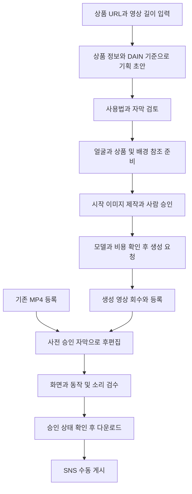

# AI 인플루언서 커머스 숏폼 자동화

**상품 기획부터 참조 자료 준비, 영상 후편집, 검수와 다운로드까지 연결하는 Java 기반 내부 운영 도구입니다.**

잇츠키핑 생활용품과 고정 AI 인물 **DAIN**을 활용한 콘텐츠 제작 과정에서 반복되는 자료 전달과 파일 처리 작업을 줄이는 것을 목표로 개발했습니다. 현재 완료 범위는 **사람의 승인을 포함하는 단일 사용자 내부 운영판 v1**입니다.

> 이 저장소는 포트폴리오 소개용 **README 전용 저장소**입니다. 소스 코드, 실행 파일, 이미지·영상, 데이터베이스와 자격증명은 포함하지 않습니다. 저장소를 복제해 프로그램을 실행할 수는 없습니다.

## 프로젝트 개요

| 항목 | 내용 |
| --- | --- |
| 대상 | 생활용품을 소개하는 세로형 SNS 콘텐츠 제작 |
| 기준 인물 | 고정 얼굴 참조와 집 배경을 사용하는 AI 인물 DAIN |
| 사용 환경 | 로컬 브라우저 기반 단일 사용자 내부 운영 |
| 결과물 | 후편집 영상, 자막, 기획 및 검수 기록을 포함한 다운로드 묶음 |
| 현재 상태 | 내부 운영 기능 구현·검증 완료, 새 콘텐츠 품질은 개별 검수 필요 |
| 기록 기준 | 2026년 10월 22일 |

## 해결하려는 문제

AI 영상 도구에서 한 편을 생성하는 것만으로는 반복적인 상품 콘텐츠 제작을 운영하기 어렵습니다. 상품별 사용법과 상황을 정리하고, 같은 인물·배경의 참조를 준비하며, 생성된 영상을 받아 자막을 넣고 검수 결과를 보존하는 작업이 남습니다.

이 프로젝트는 이러한 작업을 하나의 제작 흐름으로 연결합니다. 특히 **자동화 기능의 정상 동작과 콘텐츠의 최종 품질 승인을 분리**해, 실패하거나 확인하지 못한 결과가 승인본으로 처리되지 않도록 구성했습니다.

## 제작 흐름

시작 이미지의 정밀 보정과 최종 승인은 사람이 수행합니다. 준비된 참조를 실행기로 전달하고 후보를 등록하는 연결은 **Mock 경로로 검증**했으며, 이를 새로운 상품의 실제 합성 품질 검증으로 해석하지 않습니다.

## 구현 기능과 검증 범위

| 영역 | 구현 기능 | 검증 및 제한 |
| --- | --- | --- |
| 상품 기획 | 상품 URL 수집과 Claude CLI 기반 상황·동작·자막 초안 | 실제 상품 기획 호출 확인. 사실과 사용법은 사람 검토 필요 |
| 기획 점검 | 미확인 질문 처리와 구간별 자막 길이 제한 | 모델이 모든 누락 사실을 찾아낸다는 보장은 없음 |
| 참조 준비 | 얼굴·고정 원룸·등록된 상품 원본 조회 및 ZIP 구성 | 파일 존재와 해시 확인. 신규 상품 원본 등록·검수 필요 |
| 후보 등록 | 준비 참조와 프롬프트를 이미지 실행기에 전달 | Mock 후보 등록까지 확인. Mock은 광고 결과물로 승인 불가 |
| 제작 제어 | 공급자 모델·해상도·비용 분리, 비용 승인과 중복 제출 방지 | Seevio API의 Seedance 2.0으로 실제 단일 요청 확인 |
| 후편집 | 생성 결과 회수 또는 기존 MP4 등록 후 승인 자막 삽입 | 실제 생성 영상의 회수·후편집·ZIP 연결 확인 |
| 검수 | 원고·화면 글자·배치·상황·물리적 동작·소리·포장·규격 기록 | 최종 승인과 반려는 사람 판단 |
| 운영 보존 | 작업 조회, 승인 상태 관리, 결과 다운로드, DB·미디어 백업 | 로컬 운영 및 분리 복구 검증. 다른 PC로의 이관은 별도 검증 필요 |

### DAIN 인물과 집 배경

- 얼굴 기준 이미지와 외부 환경 기준 이미지를 자산으로 관리합니다.
- 집 장면은 기존 원룸 사진 2장을 기준으로 구조·가구·색감을 유지하도록 기획합니다.
- 현재 이미지 실행기에는 대표 원룸 1장을 연결하고, 상세 사진은 참조 묶음에 보관합니다.
- 외부 장면은 상품의 실제 사용 상황에 맞게 구성합니다.
- 참조 자산을 사용하더라도 얼굴·손·라벨·제품 외형이 완벽하게 유지되는 것은 아니므로 최종 검수가 필요합니다.

## 실제 결과와 판정

| 사례 | 확인한 결과 | 콘텐츠 판정 |
| --- | --- | --- |
| 브레스케어 | 6초 기존 영상의 후편집·검수·다운로드 운영 | **내부 승인 결과물**. 외부 인증이나 광고 성과 검증을 의미하지 않음 |
| 란도린 | Seevio API → Seedance 2.0의 5초 영상 → 회수 → 승인 자막 후편집 → ZIP | **개발 시안·콘텐츠 반려**. 분사 방식, 표정과 입술 색, 작은 포장 글자 등 개선 필요 |
| 참조 자동 연결 | 기획·얼굴·상품·집 배경 자료 전달과 후보 등록 | **Mock 연결 시험**. 실제 상품 이미지 합성 결과가 아님 |

란도린 사례는 원본 720p 영상을 1080 × 1920, 30fps로 후편집한 결과입니다. 출력 해상도를 높인 것이 원본의 디테일이나 생성 품질 향상을 의미하지는 않습니다.

## 기술 구성

| 계층 | 사용 기술 |
| --- | --- |
| 백엔드 | Java 21, Spring Boot 3.4.5, Gradle |
| 데이터 | Spring Data JPA, 로컬 파일 H2 |
| 상품 수집과 통신 | Jsoup, WebClient |
| 기획 | 기존 Claude 구독의 CLI 연동 |
| 이미지 제작 | ComfyUI·RunPod 기반 제작 경로와 Mock 실행기 |
| 영상 제작 | Seevio API를 통한 Seedance 연동 |
| 후편집 | FFmpeg·ffprobe |
| 도구 연동 | Spring AI MCP Server |
| 파일 전달 | 로컬 미디어 보관, AWS S3 연동 이력 |

현재 기본 운영은 유료 공급자와 외부 업로드를 비활성화한 로컬 모드입니다. 프로젝트 S3 자료는 백업 후 정리했으며, 향후 유료 제작을 재개하려면 전달 저장소와 비용 승인을 다시 준비해야 합니다. MariaDB 운영 배포, TTS·BGM 실서비스 전체 검증을 이번 완료 범위로 주장하지 않습니다.

## 검증과 운영 원칙

- **컴파일 및 전체 회귀 테스트 246개 통과** — 2026년 10월 22일 검증 기록 기준입니다. 공개 저장소의 CI 실행 결과는 아닙니다.
- 기존 승인 영상 조회, 후편집·검수·다운로드 흐름을 실제 브라우저에서 확인했습니다.
- 파일의 SHA-256을 비교해 결과물 복사 및 백업 무결성을 확인했습니다.
- 유료 호출은 승인 자산, 모델 설정과 비용 한도를 확인한 뒤 진행합니다.
- 거절이나 모호한 실패를 자동 재생성으로 처리하지 않습니다.
- 자막은 승인 원고를 후편집으로 삽입하고 실제 화면에서도 대조합니다.
- 펜 없이 생기는 선, 부자연스러운 제품 접촉 등 물리적 인과도 검수 대상입니다.

## 완료 범위와 남은 과제

**완료한 범위**는 기획, 참조 자료 준비, 제작 결과 등록, 승인 자막 후편집, 검수 기록과 다운로드를 연결하는 내부 운영 환경입니다.

다음 항목은 별도 개선 또는 검증이 필요합니다.

- 상품 URL만으로 매번 상업 품질의 이미지와 영상을 무인 생성
- 얼굴·손·제품 글자 및 물리적 사용 동작의 안정적인 보존
- 모든 상품의 사용법을 자동으로 정확하게 판단
- Instagram 자동 게시
- 다중 사용자 인증·권한 및 상용 서비스 배포

## 프로젝트에서 얻은 점

생성 모델 호출보다 운영 흐름과 검수 기준을 일관되게 연결하는 일이 중요했습니다. 실제 영상 생성과 파일 회수가 성공해도 광고에 쓸 수 있는 결과가 나온 것은 아니었습니다. 따라서 기능 시험, 파일 무결성, 사람의 콘텐츠 승인을 서로 다른 상태로 관리하도록 구성했습니다.

제한된 제작 비용에서는 기존 승인 자산과 Mock으로 연결을 검증하고, 실제 유료 생성은 승인된 최종 시험에 사용하는 방식이 반복 실험의 낭비를 줄이는 데 필요했습니다.

---

이 README는 프로젝트 구현과 검증 범위를 설명하는 포트폴리오 문서입니다. 소스 코드와 원본 미디어는 이 저장소에 공개하지 않습니다.
